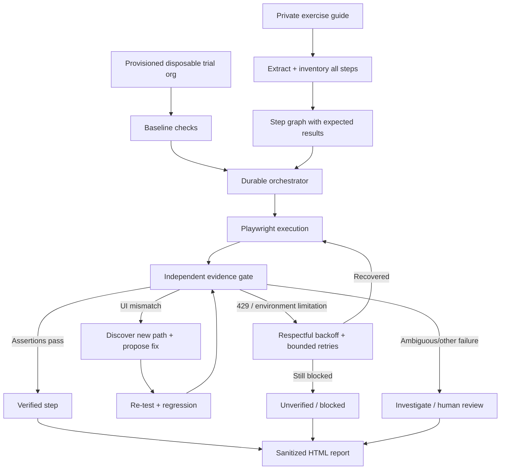

# Workshop Validator — Living Project Plan

> **Status:** Draft / discovery (not an implemented system)  
> **Pilot:** One workshop exercise guide  
> **Repository policy:** Public architecture, source code, schemas, and sanitized examples only. **No exercise guides, org credentials, session cookies, org-specific URLs, raw screenshots, or execution traces containing private data.**  
> **Last updated:** 2026-10-13

## 1. Goal

Build a cloud-hosted, multi-agent system that reads a workshop exercise guide privately, executes its instructions against a **purpose-provisioned, disposable Salesforce trial org**, independently verifies **every actionable step**, diagnoses mismatches, and produces an evidence-backed report. It must keep running on deployed cloud infrastructure when a laptop is shut down.

**Non-negotiable:** An agent's claim of confidence alone is never proof that a step passed. Unverified and blocked steps must not be counted as passed.

## 2. Scope and milestones

### First pilot: in scope
- One representative PDF guide; original remains unmodified and outside this public repository.
- Username/password authentication to the pre-provisioned workshop org, with credentials in a secret manager.
- Parse **all instructional actions** into an ordered, traceable step inventory.
- Execute through Playwright; capture private evidence for each action.
- Independently assess each expected outcome and publish a **sanitized HTML report**, with access-controlled evidence.
- Detect incorrect/outdated UI instructions, autonomously investigate alternatives, and **propose** guide corrections.
- Distinguish actual guide mismatches from trial-org platform limitations, including HTTP 429.
- Recover from transient failures with controlled, durable retries; reset disposable org state when appropriate.
- Keep execution state, audit history, and retry queues in cloud services, not in an active ChatGPT conversation.

### Later
- Faithful annotated PDF derivative that preserves the original guide's layout.
- Multi-guide generalization, team dashboards, notifications, scheduling, and integrations.

### Out of scope for the pilot
- Uploading actual exercise guides or internal workshop materials into the public repository.
- Automatically publishing revised workshop PDFs without human approval.
- Treating AI rate-limit failures as successful AI-response validations.
- Production-org testing or bypassing platform rate limits.

## 3. Proposed agent team

| Agent / service | Responsibility | Required checks |
| --- | --- | --- |
| **Durable orchestrator** | Manage runs, dependencies, retries, checkpoints, state transitions, and budgets. Consider Temporal or equivalent workflow orchestration. | No dependent step proceeds without prerequisites; no lost work after worker restart. |
| **PDF extraction agent** | Extract text, tables, page references, images, and layout anchors from the private PDF. | Reconcile each instruction/page against the generated inventory. |
| **Step planning agent** | Split instructions into atomic actions with expected outcomes, prerequisites, selectors, and verification criteria. | Identify ambiguous, conditional, AI-dependent, and manual-only steps explicitly. |
| **Playwright authoring agent** | Produce maintainable browser automations using stable accessible locators where possible. | Type-check/lint; avoid brittle selectors and fixed sleeps. |
| **Browser execution worker** | Log in, run one action at a time, capture timing, DOM/UI assertions, screenshots, and sanitized errors. | Record what actually ran; make restarts and retries safe. |
| **Independent verification agent** | Compare observed evidence with expected outcomes independently of the action-generating agent. | Hard assertions and adequate evidence are mandatory for PASS. |
| **Error classification and recovery agent** | Separate UI mismatch, 429/rate limits, transient outages, authentication errors, bad initial state, and true functional failures. | Retry only retriable classes; never mask an unresolved limitation. |
| **UI discovery / repair agent** | Search for an updated UI path and propose a minimal change to automation and guide instructions. | Re-execute and independently verify before accepting a proposed fix. |
| **Org state manager** | Validate initial org prerequisites, seed/reset disposable data, and capture a reproducible baseline. | Confirm expected workshop-specific provisioning before each full run. |
| **Regression / adversarial QA agent** | Rerun repaired paths and earlier dependent paths, exercise negative tests, and find missing coverage. | A repair must not silently break an already verified step. |
| **Reporting agent** | Produce HTML summary, private evidence index, per-step confidence, error taxonomy, and proposed edits. | Every claim links to a step ID and evidence ID. |
| **PDF annotation agent (later)** | Produce a reviewable, layout-faithful annotated copy of the guide. | Visual diff and human review; never overwrite the source. |

Agents may be separate processes/services or isolated roles implemented within fewer workers; **independent verification** is a logical separation that should not share the executor's unverified conclusion.

## 4. End-to-end workflow

1. **Ingest privately:** Obtain the chosen PDF, target org configuration, permissions, and credentials from approved private storage.
2. **Confirm baseline:** Assert that the org has the specific workshop's expected initial configuration and record a baseline ID.
3. **Inventory all steps:** Give each action a stable `step_id`, source page/region, exact instructional text reference, prerequisites, expected result, and required verification.
4. **Completeness gate:** Compare parsed steps against the source page-by-page. Missing, ambiguous, or non-automatable instructions must be identified, not silently dropped.
5. **Generate automation:** Build an executable Playwright test graph with explicit preconditions and postconditions.
6. **Execute atomically:** Persist checkpoints; run an action, collect evidence, then invoke independent verification.
7. **Classify outcome:** PASS, UI_MISMATCH, FUNCTIONAL_FAIL, ENV_BLOCKED, AUTH_BLOCKED, NEEDS_REVIEW, or NOT_RUN.
8. **Repair/retry:** For UI mismatches, discover a candidate route, propose the exact correction, test it, and rerun verification. For transient failures, apply bounded exponential backoff and retry after a reasonable cooldown.
9. **Respect dependencies:** Never continue into steps that depend on an unresolved prerequisite. Independent branches may continue if the selected policy allows it.
10. **Regression:** Re-test the modified path from a reproducible starting state, and run a clean end-to-end pass when possible.
11. **Report:** Generate sanitized HTML with private evidence links, statuses, confidence, proposed edits, blocked reasons, and actionable next steps.
12. **Human review:** Review guide changes and remaining ambiguous/blocked steps before any updated PDF is published.



## 5. Per-step evidence and confidence gates

Required step record:

```json
{
  "step_id": "S-015",
  "source_page": 7,
  "status": "ENV_BLOCKED",
  "expected_result": "A response is generated",
  "observed_result": "HTTP 429 while invoking AI generation",
  "assertions": [{"name": "AI response visible", "passed": false}],
  "evidence_refs": ["private://run-id/step-015/screenshot"],
  "confidence": {"score": null, "level": "unverified", "basis": "Required assertion blocked"},
  "dependency_ids": ["S-014"],
  "proposed_guide_change": null
}
```

**PASS policy:**
- Every required assertion succeeds against observed state; a screenshot or an LLM opinion by itself is insufficient.
- Evidence must be attributable to the correct org, run, source instruction, and step.
- Verification is independent from script generation/execution and can reject unsupported claims.
- Confidence is recorded for each step, combining evidence coverage, assertion quality, selector stability, and repeatability. **No claim of literal 100% certainty**; numeric scores require calibration against pilot runs before they are treated as probabilities.
- A high confidence score **cannot override** a failed or missing required assertion.
- Each action is represented, even when it is skipped, manual, ambiguous, or blocked; coverage is distinct from pass rate.

## 6. Trial-org LLM gateway handling

Some guide steps require actual generative AI output. Trial or sandbox gateway quotas can return HTTP 429. The guide, rather than a general assumption, determines whether AI generation is a required assertion.

- Tag the event as `ENV_BLOCKED` when a credible quota/rate-limit response prevents the required check.
- Record status code, timestamp, retry-after/cooldown data if present, and sanitized context.
- Honor rate-limit guidance; use bounded backoff, jitter, a retry budget, and durable re-queueing. **Do not attempt to evade limits.**
- If a step merely opens a builder page, verify its UI independently of the blocked AI generation.
- If generating an AI response is essential, **do not mark that step PASS** until it succeeds and is independently verified.
- Prevent dependent steps from passing; handling of *independent* steps after a persistent 429 remains an open product decision below.

## 7. Robustness, safety, and operations

- **Cloud durability:** a managed workflow engine, queue, and cloud worker runner; checkpoints survive crashes or laptop shutdown. This is an architecture requirement, **not yet deployed**.
- **Least privilege:** short-lived sessions where possible; secrets never in Git, reports, logs, PRs, or prompts unless strictly required for an authorized step.
- **Data handling:** private encrypted artifact storage for source PDFs, raw screenshots, Playwright traces, and runs; retention period and access policy TBD.
- **Public repository:** source code, redacted fixtures, JSON schemas, architectural docs, test harness, and the living plan only. Add `.gitignore` and secret scanning before substantive implementation.
- **Guardrails:** rate limits, spend caps, max retries, timeouts, loop detection, escalation queue, and human approval for destructive changes outside disposable orgs.
- **Observability:** trace IDs, run IDs, agent decisions, assertions, failure categories, retry counts, and reproducible baseline IDs.

## 8. Build and evaluation phases

| Phase | Deliverable | Exit criterion |
| --- | --- | --- |
| **P0: Planning & setup** | This plan; one approved guide; provisioned trial-org baseline; private artifact/secrets approach | Dependencies and open policies documented |
| **P1: Extraction** | Step manifest + page/region mapping + completeness checker | Every source instruction accounted for or explicitly flagged |
| **P2: Single-guide execution** | Playwright runner, org reset, independent QA and checkpointing | Each executable step produces inspectable evidence and a truthful status |
| **P3: Recovery** | UI discovery proposals, 429 classification, bounded retries, regression | Known UI changes and known rate limits classified correctly |
| **P4: Cloud persistence** | Durable workflow + artifact store | Run survives worker restart and laptop closure |
| **P5: Reviewable report** | HTML report + sanitized summaries + private screenshot/trace links | Report supports step-by-step audit and distinguishes all blocked steps |
| **P6: PDF output (later)** | Annotated PDF copy with layout comparison | Page layout verified and corrections reviewed |

Pilot success is measured by **step inventory coverage**, required-assertion pass rate, false-PASS rate (target: zero in test cases), reproducibility across clean resets, repair success rate, time/cost per run, and accurate blocked-step reporting. An end-to-end green result requires all *required* steps to be verified; an otherwise useful run can be reported as **incomplete**.

## 9. Open decisions for review

1. **Persistent 429 (next decision):** Recommended: continue *independent* steps, keep affected/dependent steps blocked, and retry later. Alternative: pause the entire exercise.
2. Evidence retention: where and for how long to store guides, screenshots, traces, and reports privately?
3. Guide corrections: who approves proposed text changes before an annotated PDF is distributed?
4. Baseline reset: what mechanism recreates a correctly provisioned workshop org between runs?
5. Confidence calibration: what empirical benchmarks and threshold must be met before production use?
6. Infrastructure choice and budget for a durable cloud runner.

## 10. Change management

This file is a **living, version-controlled draft**. Update it when decisions change, using descriptive commits and, once multiple contributors are involved, pull requests. Keep decisions separate from implementation status; do not label a proposed agent or capability as deployed until independently demonstrated.

**Current state:** Plan drafted. No cloud orchestrator, agents, Playwright tests, or PDF annotation pipeline have been deployed.
