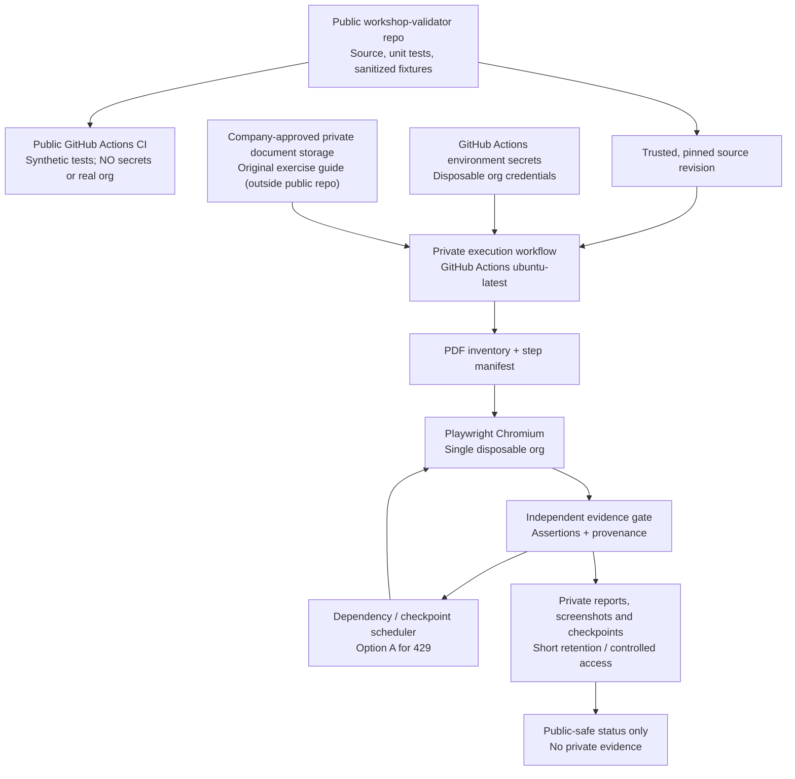

# $0-first Cloud Architecture — Workshop Validator

> **Decision date:** 2026-10-13
> **Status:** Approved architecture direction; **not deployed**.
> **Budget target:** $0 additional monthly infrastructure and $0 external LLM spend during the pilot.
> **Pilot:** One workshop guide, one purpose-provisioned disposable Salesforce trial org.
> **Public repository:** `teomarcelo/workshop-validator` (source, tests, documents and sanitized fixtures only).

## Architecture decision

Use **standard GitHub-hosted GitHub Actions runners**, not an always-on VM, as the first unattended execution platform. Separate **public, secret-free code/test workflows** from **private, credentialed guide validation**. Preserve a private boundary around all exercise-guide PDFs, org credentials, screenshots, Playwright traces, and full HTML evidence. The existing ChatGPT hourly development task is not the browser runner, and does not count as a deployed validation workflow.

## Cost envelope

| Component | Pilot choice | $0 condition / caveat |
| --- | --- | --- |
| Public source and documentation | Existing public GitHub Free repository | $0 for repository hosting under GitHub Free. |
| Public CI/unit tests | Standard `ubuntu-latest` GitHub-hosted Actions runners | $0 compute for public repositories on standard runners; never enable larger runners or paid third-party tools. |
| Private Salesforce/PDF execution | Separate **private** GitHub repo/workflow with standard `ubuntu-latest` | GitHub Free includes **2,000 private Actions minutes per month across the account** and **500 MB of shared artifact/package storage**. Monitor actual usage of all private repos. Beyond allowances may incur charges depending on billing settings. |
| Browser and PDF tooling | Python, Playwright Chromium, free/open-source PDF tools | No recurring license assumed; check dependencies' licenses and install runtimes only when needed. |
| Orchestration (pilot) | GitHub Actions `workflow_dispatch`, optional `schedule`, `concurrency`, SQLite/JSON checkpoints | No paid scheduler. Actions starts bounded jobs, **not** a 24/7 durable process. Cross-run resume needs private checkpoint persistence and revalidation. |
| Private PDFs / evidence | Existing **company-approved** private storage; provider and access integration TBD | Must be available without additional billing and explicitly approved for workshop materials. No claim of $0 or live execution until confirmed. |
| Secrets | GitHub Actions *private workflow* environment/repository secrets | GitHub secret values must be entered by the authorized repo operator after credential rotation. The chat is not a secret manager. |
| External AI inference | **Disabled in $0 phase** | No paid LLM APIs, Copilot agent minutes, or third-party agent platforms; use deterministic assertions and human review when ambiguous. |
| Notification/dashboard | Private workflow result / restricted HTML report | No paid email, Slack, always-on dashboard, or custom domain. |

**Illustrative private-minute cap:** A single daily validation run capped at 30 minutes is at most about 900 runner-minutes in a 30-day month, leaving about 1,100 of the GitHub Free 2,000-minute allowance for other private usage. This is a **planning cap, not a guarantee of sufficient runtime** or free availability: other private repos share the allowance, reruns consume minutes, and a 32-page guide may require splitting work across jobs/days. Start with **manual runs** and a small step subset; enable nightly scheduling only after baseline and security gates succeed. Set an account/Actions budget or spending limit of $0 if supported; monitor GitHub Billing and never intentionally exceed free allowances. Do not assume a ChatGPT subscription covers LLM API charges.

Sources:
- GitHub Actions pricing and public/private allowances: https://docs.github.com/en/billing/concepts/product-billing/github-actions
- Standard runner availability: https://docs.github.com/en/actions/reference/runners/github-hosted-runners
- Scheduled workflow behavior: https://docs.github.com/en/actions/reference/workflows-and-actions/events-that-trigger-workflows
- Security guidance: https://docs.github.com/en/actions/reference/security/secure-use
- Artifact visibility: https://docs.github.com/en/rest/actions/artifacts
- Secret size and practices: https://docs.github.com/en/actions/reference/security/secrets

## Two workflow boundaries

### 1. Public CI (first implementation milestone)

- In `workshop-validator`, create a `push` / `pull_request` workflow running the combined Python unit suite, compile checks, and **synthetic PDF fixtures only**.
- `permissions: contents: read`; never inject org secrets into public workflows; never collect private browser evidence.
- Use official/pinned actions and controlled dependency versions; forbid untrusted PR code in any secret-bearing workflow.
- GitHub Actions run history gives a verifiable per-commit result. No need to wait for the hourly ChatGPT task to run these tests.

### 2. Private validation workflow (second implementation milestone)

- Use a **separate private runner repo** or another approved private automation space. This repo need not contain the exercise-guide PDFs themselves.
- Copy or fetch a **pinned trusted revision** of the public validator code. Run from the protected default branch, not from untrusted fork or pull-request code.
- Begin with `workflow_dispatch`; optionally enable a once-daily `schedule` after proving a manual real-org run. Example off-peak UTC cron: `17 9 * * *` (09:17 UTC, not a guaranteed local hour).
- `runs-on: ubuntu-latest`, `timeout-minutes: 30` initially, `concurrency` limiting to one active validation per disposable org, and `permissions: contents: read`.
- Install pinned Python dependencies plus Playwright Chromium in the ephemeral runner; do not assume the runner preserves installed software or data between runs.
- Fetch the exercise guide from an **explicitly approved private document source** using scoped authentication. **Do not commit real guide files, including to the public code repo.** Avoid using a 48 KB GitHub Actions secret as a way to store a multi-page PDF.
- Inject the trial-org username/password only from restricted secrets, **after rotating credentials previously pasted in chat**. Redact output, do not print environment variables, and avoid uploading browser traces/logs until reviewed.
- Save step-by-step statuses and evidence only to controlled private storage. Private Actions artifacts may be used temporarily if company policy permits; set e.g. `retention-days: 7`, restrict repo access, cap uploads and storage use. Raw screenshots/traces must never be uploaded to the **public** repository or its Actions artifacts.
- Produce a private HTML report and, separately, a **sanitized** high-level status summary in the public repo only if explicitly approved. Keep error codes and assertion IDs; remove org-identifying fields, source guide text and customer data.

## Execution and QA policy

1. Read and inventory *every* actionable instruction from the chosen PDF into an immutable manifest, preserving source page/region references privately; flag extraction uncertainty rather than omit a step.
2. Verify the disposable org baseline; check login, permissions, provisioning, and expected initial state before destructive or mutable actions.
3. Execute an eligible instruction with Playwright using accessible locators and explicit waits. Collect typed DOM/API observations and private screenshots.
4. The independent verifier uses manifest-defined assertions, not an executor's PASS assertion. Only evidence-backed results unlock downstream dependencies.
5. Respect **Option A**: 429/rate-limited steps remain unverified. Continue truly independent branches; pause dependent branches; retry with rate-limit-aware cooldown and bounded attempts. No rate-limit bypass.
6. Persist a sanitized checkpoint for each transition. Within-run SQLite is useful but not automatically durable across ephemeral GitHub-hosted runners; a separate **private persisted checkpoint + idempotent restore protocol** is required for cross-run resume. Until built, a restarted job may need to reset the disposable org and begin from an earlier verified baseline.
7. Cap retries and total run time. A hit timeout, unsatisfied assertion, incomplete source inventory or missing evidence results in `INCOMPLETE` / `NEEDS_REVIEW`, never a green report.
8. No paid agent discovery in this phase. If a UI label has moved, use deterministic accessibility-tree candidates to propose a change for instructor review; leave uncertain repairs unverified.

## Run visibility and reliability

- Every real GitHub Actions run has a run ID, triggering SHA/ref, UTC start/end, outcome and controlled logs. Record step counts (PASS / FAIL / BLOCKED / NOT_RUN), checkpoint ID, tested commit, retry counts, and reasons without private content.
- Provide a private report and, for public CI, a safe check status. Monitor missed schedules; GitHub warns scheduled jobs can be delayed or dropped under load, and inactive public-repo schedules can be disabled after 60 days.
- Set an upper bound of one live validation at a time per org and 30 minutes per pilot run; never turn on continuous, overlapping, or unbounded cron jobs to mimic a permanently running worker.
- The ChatGPT hourly task may continue contributing code/reviews and tracking milestones, but **only completed GitHub Actions run records** count as proof of deployed unattended browser execution.

## Implementation sequence and exit gates

| Gate | Work | Definition of done |
| --- | --- | --- |
| **G0** | Verify price/security assumptions and add this plan | Docs committed; no secrets or PDFs leaked. |
| **G1** | Add public CI for scheduler, verifier, SQLite checkpoint and future PDF tests | A real GitHub Actions test run succeeds on the public repo, including the combined suite. |
| **G2** | Add browser/PDF adapter with **synthetic** guide and local demo UI | One synthetic instruction runs end-to-end through Playwright and independently verifiable evidence. |
| **G3** | Establish approved private runner, private document access and rotated org secrets | Operator verifies permissions, $0 budget limits and confidential data boundaries; manual smoke run can authenticate without leaks. |
| **G4** | Execute one **real guide** task in the provisioned disposable trial org | Verifier proves the expected UI outcome with private evidence; failures are reported truthfully. |
| **G5** | Expand to the full guide + dependency-aware recovery + private report | Every step accounted for, blocked steps not passed, repeatable from baseline; cost below account quota. |
| **G6** | Enable daily trigger and resumption with private checkpoints | A scheduled run succeeds independently of laptop state; interruption recovery and evidence retention are tested. |
| **Later** | True durable orchestration / autonomous LLM-powered UI repair / annotated PDFs | Separate cost and security review. Not promised at $0. |

## Risks and decisions requiring approval

1. **Document location:** Confirm an approved *existing* private document service and a safe machine-to-machine access mechanism. The uploaded chat PDF is not automatically available to GitHub Actions.
2. **Private runner:** Confirm GitHub personal/private repo use is allowed for the workshop material and access; otherwise use a company-approved execution space even if that changes cost.
3. **Secrets:** Rotate the password already provided in chat; enter the new secret only through the chosen private environment. No secret storage integration has been configured yet.
4. **Budget controls:** Confirm actual Actions included minutes and other account usage, shared storage, budget settings, and ability to stop at $0.
5. **Evidence retention:** Obtain organizational approval for what may be captured, who can access it, and maximum retention.
6. **Coverage/clock:** A 30-minute job may not finish a full 32-page guide; decide whether to split the run, reduce frequency, or revisit the $0 constraint.
7. **Autonomous AI:** Full autonomous LLM repair at external API scale is **not** included for $0. Any optional model usage requires a separate approved budget and safety review.

## Current deployment status

- **Exists:** Public repo; Python dependency scheduler, independent evidence gate, and SQLite checkpoint prototypes, with unit tests reported in `AUTOMATION_LOG.md`.
- **Not yet built or verified:** GitHub Actions CI workflow, private runner, private PDF access, encrypted cross-run persistence, Playwright integration, live Salesforce exercise tests, or scheduled cloud validation.
- **No resource deployment and no external charges authorized by this design document.**
